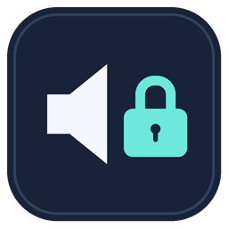

<a id="readme-top"></a>

[![Windows build][build-badge]][build-url]
[![Issues][issues-badge]][issues-url]

<div align="center">
  
  <h1>windows-lockscreen-mute</h1>
  <p>A small Windows tray utility that silences audio while your session is locked.</p>
  <p>
    <a href="https://github.com/Swmarly/windows-lockscreen-mute/releases/latest">
      
    </a>
  </p>
  <p>
    <a href="#getting-started"><strong>Get started »</strong></a>
    · <a href="https://github.com/Swmarly/windows-lockscreen-mute/issues/new">Report a bug</a>
    · <a href="https://github.com/Swmarly/windows-lockscreen-mute/issues/new">Request a feature</a>
  </p>
</div>

<details>
  <summary>Table of contents</summary>

  - [About the project](#about-the-project)
  - [Getting started](#getting-started)
  - [Usage](#usage)
  - [Contributing](#contributing)
  - [Acknowledgments](#acknowledgments)
</details>

## About the project

Locking Windows mutes every active playback device. Unlocking restores sound only on devices the utility muted. Devices that were already muted stay muted. The utility uses each device’s mute switch, so its volume level and the default playback device stay the same.

### Built with

Native C++17, Win32 session notifications, and Windows Core Audio. The utility runs as a single executable with no installer or additional runtime dependencies.

<p align="right">(<a href="#readme-top">back to top</a>)</p>

## Getting started

### Prerequisites

- Windows 10 or 11.
- To build from source, install Visual Studio 2022 or Build Tools with **Desktop development with C++** and a Windows SDK.

### Installation

Download `windows-lockscreen-mute.exe` from **Assets** on the [latest release][latest-release]. Save the executable to a permanent folder and run it.

To build from source, open an **x64 Native Tools Command Prompt for VS 2022** and run these commands from the checkout.

```bat
build.cmd
build\windows-lockscreen-mute.exe
```

<p align="right">(<a href="#readme-top">back to top</a>)</p>

## Usage

Open the speaker-and-padlock icon in the system tray. Windows may place it under **Show hidden icons**.

| Menu item | Behavior |
| --- | --- |
| **Mute when Windows locks** | Enables automatic muting. On by default. |
| **Launch with Windows** | Starts the utility at sign-in for your Windows account. Off by default. |
| **Exit** | Restores any mute changes still owned by the utility and closes it. |

Press **Win + L** to lock your session. Playback devices that become active while locked are picked up within about two seconds. Leave the utility running through unlock so it can restore mute changes. If you move the executable, toggle **Launch with Windows** off and back on from its new location.

<p align="right">(<a href="#readme-top">back to top</a>)</p>

## Contributing

Build with `build.cmd` and run the executable on Windows. Before opening a pull request, check these cases:

1. Start with audible playback, lock the session, and confirm that sound stops. Unlock and check that sound resumes at the same volume and on the same device.
2. Mute a playback device before locking. Confirm it stays muted after unlock. With two devices, start with one muted and one unmuted to check that their states are handled independently.
3. Connect another playback device while locked and verify its mute state through unlock.
4. Toggle automatic muting and confirm the preference survives restarting the utility. Enable launch at sign-in, sign out and back in, then disable it and check the next sign-in.

Report bugs and feature requests through [GitHub Issues][issues-url].

<p align="right">(<a href="#readme-top">back to top</a>)</p>

## Acknowledgments

- [Best-README-Template](https://github.com/othneildrew/Best-README-Template)
- [Windows Core Audio documentation](https://learn.microsoft.com/windows/win32/coreaudio/core-audio-apis-in-windows-vista)

<p align="right">(<a href="#readme-top">back to top</a>)</p>

[build-badge]: https://github.com/Swmarly/windows-lockscreen-mute/actions/workflows/build.yml/badge.svg
[build-url]: https://github.com/Swmarly/windows-lockscreen-mute/actions/workflows/build.yml
[issues-badge]: https://img.shields.io/github/issues/Swmarly/windows-lockscreen-mute
[issues-url]: https://github.com/Swmarly/windows-lockscreen-mute/issues
[latest-release]: https://github.com/Swmarly/windows-lockscreen-mute/releases/latest
